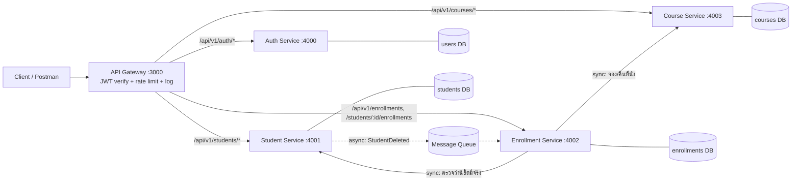

# ออกแบบสถาปัตยกรรม Microservices ของระบบ Student API

ระบบเดิมเป็น Monolith (Express + MySQL ก้อนเดียว) แบ่งตาม **Bounded Context** ของโดเมน ไม่ได้แบ่งตามชั้นเทคนิค (route / service / repository)

## การแบ่งบริการ

| บริการ             | ความรับผิดชอบ (Bounded Context)                                   | ข้อมูลที่เป็นเจ้าของ    | Endpoint หลัก                                                                                                         |
| ------------------ | ----------------------------------------------------------------- | ----------------------- | --------------------------------------------------------------------------------------------------------------------- |
| Auth Service       | ตัวตนผู้ใช้ สมัคร/เข้าสู่ระบบ ออก JWT จัดการ role                 | `users`                 | `POST /auth/register`, `POST /auth/login`, `GET /auth/me`, `PATCH /auth/change-password`                              |
| Student Service    | ข้อมูลนิสิต (โปรไฟล์ สาขา อีเมล) และการแก้ไขเฉพาะระเบียนของตนเอง  | `students`              | `GET/POST /students`, `GET/PUT/PATCH/DELETE /students/:id`                                                            |
| Course Service     | รายวิชา หน่วยกิต และจำนวนที่นั่งว่าง                              | `courses`               | `GET/POST /courses`, `GET/PUT/DELETE /courses/:id`, `POST /courses/:id/seats/reserve`, `POST /courses/:id/seats/release` |
| Enrollment Service | การลงทะเบียนเรียน (นิสิตคนไหนลงวิชาไหน) และกติกาการลงทะเบียน       | `enrollments`           | `POST /students/:id/enrollments`, `DELETE /students/:id/enrollments/:courseId`, `GET /students/:id/courses`, `GET /enrollments` |
| API Gateway (ไม่ใช่ service ย่อย) | จุดเข้าเดียว: ตรวจ JWT, routing, rate limit, logging รวมศูนย์ | —                       | `/api/v1/*` ส่งต่อไปยังบริการตาม path                                                                                  |

หมายเหตุการแบ่ง

- `seat_available` อยู่ใน Course Service เพราะเป็น "ความจุของรายวิชา" ส่วน Enrollment Service เป็นเจ้าของแค่ความสัมพันธ์ (student_id, course_id) ไม่มี FK ข้าม service แล้ว เก็บเป็น id อ้างอิงเฉยๆ
- `students.user_id` เก็บเป็น id ของ user ที่อ้างอิงจาก Auth Service (ไม่ JOIN ข้ามฐานข้อมูล)
- GraphQL (`/graphql` ที่ยังเป็นข้อมูลจำลอง in-memory) ไม่ได้อยู่ในแผนแยก เก็บไว้เป็น legacy หรือย้ายไปอยู่หลัง Gateway ภายหลัง

## แผนภาพสถาปัตยกรรม

เส้นทึบ = เรียกแบบ Synchronous (HTTP), เส้นประ = Asynchronous (event)

## รูปแบบการสื่อสาร

| จาก                | ไป                 | รูปแบบ       | เหตุผล                                                                                                          |
| ------------------ | ------------------ | ------------ | --------------------------------------------------------------------------------------------------------------- |
| Gateway            | ทุกบริการ          | Synchronous  | Client รอผลลัพธ์ทันที (request/response)                                                                        |
| Enrollment Service | Student Service    | Synchronous  | ต้องรู้ผลก่อนว่านิสิตมีตัวตนจริงหรือไม่ ถึงจะลงทะเบียนต่อได้                                                     |
| Enrollment Service | Course Service     | Synchronous  | ต้องจองที่นั่งให้สำเร็จก่อนบันทึกการลงทะเบียน (เดิมทำใน DB transaction เดียว แยกบริการแล้วต้องเรียกตอบกลับทันที) |
| Student Service    | Enrollment Service | Asynchronous | เมื่อลบนิสิต ให้ Enrollment ลบ/ยกเลิกรายการตามภายหลังได้ (แทน `ON DELETE CASCADE`) ไม่ต้องให้ผู้ใช้รอ            |
| Gateway            | Auth Service       | ไม่เรียก     | Gateway ตรวจ JWT เองจากลายเซ็น (shared secret/public key) ลดการเรียกซ้ำทุก request                              |

**ประเด็นที่ต้องระวัง:** เดิม "ลงทะเบียน" = transaction เดียวใน MySQL (`SELECT ... FOR UPDATE` → INSERT → UPDATE seat) พอแยกฐานข้อมูลจะไม่มี transaction ข้ามบริการ จึงใช้ลำดับ _จองที่นั่ง → บันทึก enrollment_ และถ้าบันทึกไม่สำเร็จให้เรียก `seats/release` ชดเชย (แนวคิด Saga แบบง่าย)

## จุดที่ต้องมี Resilience

| บริการที่เรียก     | บริการปลายทาง      | Retry / Timeout / Fallback                | เหตุผล                                                                                                                            |
| ------------------ | ------------------ | ----------------------------------------- | --------------------------------------------------------------------------------------------------------------------------------- |
| Gateway            | ทุกบริการ          | **Timeout** 3 วินาที + **Fallback** 503   | กันค้าง และตอบ `503 SERVICE_UNAVAILABLE` ที่มีความหมาย (ทดสอบแล้วใน lab) ไม่ Retry อัตโนมัติกับ POST/PUT/DELETE เพราะอาจทำซ้ำ     |
| Enrollment Service | Student Service    | **Timeout** + **Retry** 2-3 ครั้ง (backoff) | เป็นการอ่าน (GET) ซ้ำได้ปลอดภัย ล้มเหลวชั่วคราวจากเครือข่ายพบบ่อย; ถ้าครบแล้วยังไม่ได้ → `503` ไม่ลงทะเบียน (ห้ามเดาว่านิสิตมีจริง) |
| Enrollment Service | Course Service     | **Timeout** + **Retry เฉพาะ release**     | `seats/reserve` ไม่ idempotent จึงไม่ Retry มั่ว (ใช้ idempotency key ถ้าจะ Retry); `seats/release` (ชดเชย) ต้อง Retry จนสำเร็จ    |
| Student Service    | Message Queue      | **Retry** + dead-letter queue             | ถ้าส่ง event `StudentDeleted` ไม่สำเร็จต้องไม่หาย                                                                                 |
| Gateway            | Auth Service       | ไม่จำเป็น                                 | ไม่ได้เรียกตอน request ปกติ (ตรวจ JWT เอง) เรียกเฉพาะ `/auth/*` ซึ่งใช้ Timeout + Fallback 503 ตามกฎของ Gateway                    |